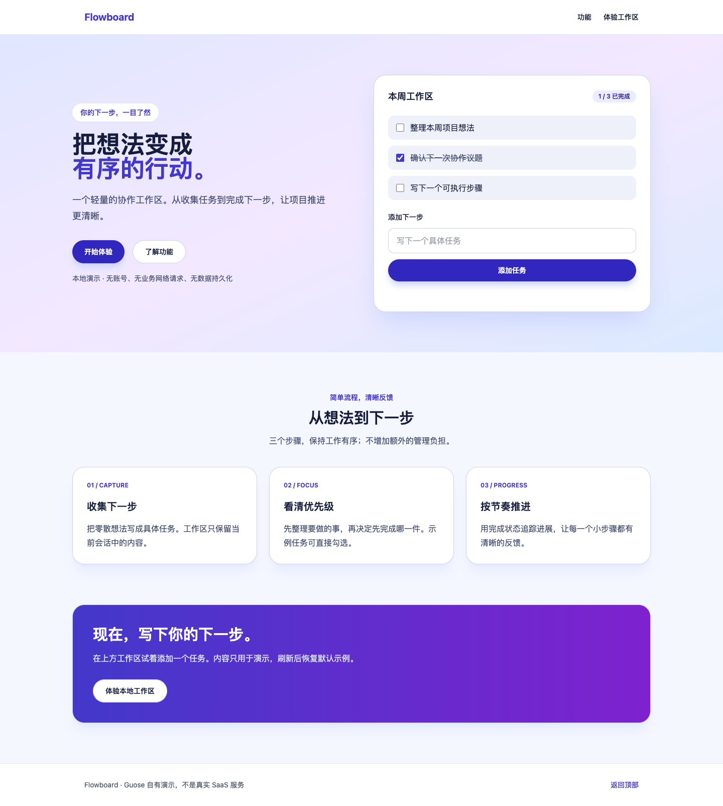
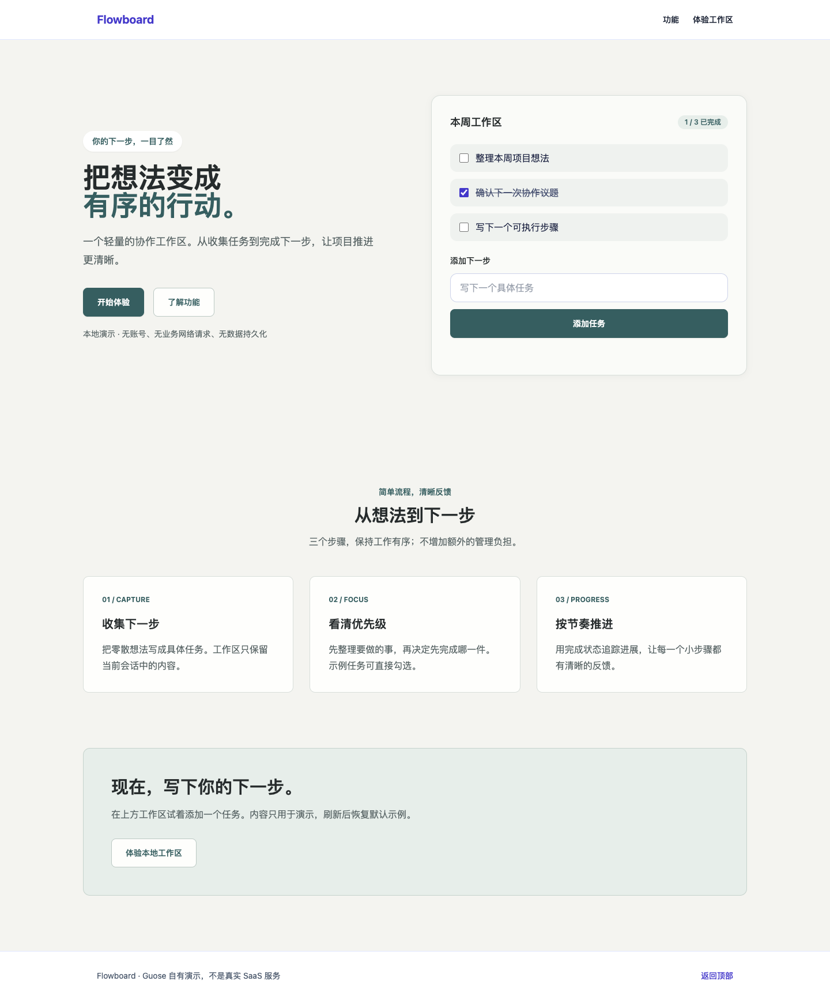

# Guose

**Tell Guose what you want before it touches your code.**

Guose is an intent-first, evidence-aware frontend transformation tool. Turn a
vague design request into a scoped, reviewable plan, rather than an autonomous
redesign. Human approval, source provenance and honest UNKNOWNs come first.
Execution currently supports our owned React + Tailwind demo only; arbitrary
repositories and production use are **not validated**.

Describe intent → Clarify → Review brief → Compile plan → Human approval →
Transform isolated copy → Review diff → Undo

## A real, human-guided example

| Before | After |
| --- | --- |
|  |  |

[Mobile before](docs/assets/before-mobile.png) · [Mobile after](docs/assets/after-mobile.png)

Existing manually visually approved **trusted-demo** screenshots. The After was
produced in the earlier human-guided/native-host loop, **not** by P2 automation.
Protected Navbar/Footer remain unchanged. No random third-party result or
automatic visual approval is implied.

The separate P2 executor result is smaller: **39 approved operations, 4 APPLIED,
34 SKIPPED_UNKNOWN, 1 SKIPPED_SCOPE**. Guose skips operations it cannot safely
materialize. This is a boundary, not a statistical safety percentage.
[Capabilities](CURRENT_CAPABILITIES.md) · [Validation](docs/VALIDATION.md)

## Quick start — source checkout, not an npm release

Use Node **24**, npm and Git. Clone or download the public source repository first.
No published npm package or hosted service exists.

```sh
npm ci --ignore-scripts
npm run build
node dist/cli/index.js --help
node dist/cli/index.js scan examples/guose-demo-app --json
node dist/cli/index.js recover examples/guose-demo-app --json
npm run demo:workflow -- --inspect
```

Inspect displays the existing sample as an **unapproved current draft** and fresh
demo evidence. It never authorizes or transforms. For new intent, use the upstream
[grill-me integration](docs/GRILL_INTEGRATION.md); this helper intentionally
supports only the existing sample and owned demo.

```sh
npm run demo:workflow -- --interactive
```

Requires a human terminal: confirm the displayed Brief hash, TargetBinding hash,
classify each operation, approve the exact plan hash, then separately authorize
isolated execution. No historical approval is reused. The helper prints the real
diff and temporary workspace. Inspect before pressing Enter to undo and clean up.
Later source edits cause undo to stop instead of overwriting changes. Do not kill
the process: undo authority is process-local; termination can retain a temporary
copy. This is a development script/API workflow, not a general transformation CLI
or screenshot engine.

To view the **unchanged baseline** in a second terminal:

```sh
cd examples/guose-demo-app
npm ci --ignore-scripts
npm run dev
```

Vite prints its local URL. In the printed isolated workspace you may run
`npm ci --ignore-scripts`, `npm run lint`, `npm run typecheck`, `npm test` and
`npm run build`. This permission applies only to the **owned trusted demo**,
not analyzed third-party code. Existing node_modules are not copied.

## Current limitations

- React + Tailwind/shadcn-compatible narrow scope only.
- Owned trusted demo is the primary validated transformation target.
- Executor skips unresolved shared ownership, dynamic classes and unsafe partial
  color combinations; it does not execute the complete plan.
- Human plan approval required; no automatic whole-repo transformation.
- Third-party repo execution and production use not validated.
- No automated preview/screenshots/visual approval, Web UI or model API.
- Confidence is a deterministic heuristic, not probability or permission.

Analysis `scan` / `recover` and legacy `plan` / dry-run `patch` / static `verify`
never run target code. Static verify is **not** a runtime build/test result.
Brief-bound compiler/executor live in APIs and the demo helper, not legacy CLI
`plan`. Saved JSON does not restore execution authority. [Security](SECURITY.md)

## Develop and contribute

```sh
npm run lint
npm run typecheck
npm test
npm run build
npm run test:locale
npm run test:grill
git diff --check
```

Contribute bounded detectors, recovery rules, transformation rules and verification
with reproducible negative fixtures. New frameworks, strategies and Grill/model
adapters need scope agreement; no stable public plugin ABI is promised.
[Contributing](CONTRIBUTING.md) · [MIT](LICENSE) ·
[Third-party notices](THIRD_PARTY_NOTICES.md) · [Conduct](CODE_OF_CONDUCT.md)

Current source candidate **v0.1.0-rc.1**, not a tagged GitHub release or production-readiness claim.
Public repository history begins with the v0.1 release candidate. Earlier
development history is intentionally not published because it contains local
development and audit artifacts; this is not the project's first development day.
[Release checklist](RELEASE_CANDIDATE_CHECKLIST.md) records remaining requirements.
No usage, adoption or Codex-for-OSS eligibility is claimed.
